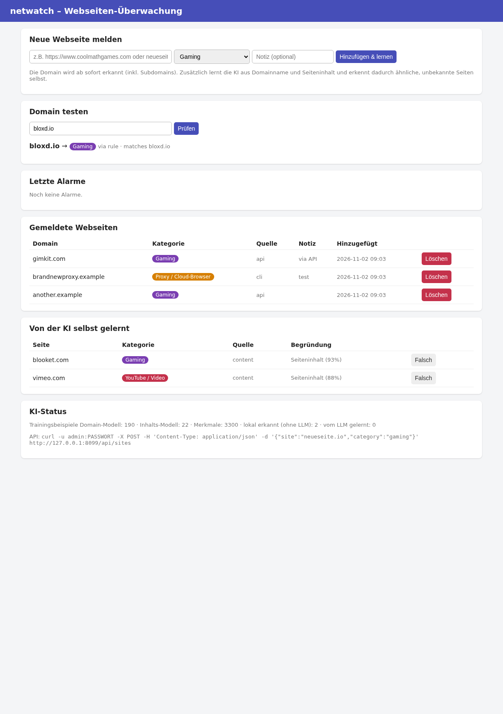

# netwatch – Teams-Alarm bei YouTube, Gaming & Proxy-Seiten

`netwatch` schneidet den Netzwerkverkehr mit, erkennt aufgerufene Domains und schickt eine
Nachricht (Adaptive Card) in einen Microsoft-Teams-Kanal, wenn ein Gerät

* **YouTube** (inkl. `googlevideo.com`, `ytimg.com`, `youtu.be` …),
* eine **Gaming-Seite** (Steam, Roblox, Epic, Poki, CrazyGames, Twitch, `*.io`-Games …) oder
* einen **Proxy / Cloud-Browser** wie **browser.lol**, Hyperbeam, CroxyProxy, Unblocker …

öffnet.

## Wie es erkennt

1. **Quellen** – DNS-Anfragen (UDP/TCP 53) und der Hostname aus dem TLS-Handshake (SNI, TCP 443).
   HTTPS-Inhalte werden *nicht* entschlüsselt.
2. **Regeln** – kuratierte Domainlisten pro Kategorie (`netwatch/classifier.py`, erweiterbar in der Config).
3. **Heuristik** – Schlüsselwörter im Domainnamen (`proxy`, `unblock`, `unblocked-games`, `spiele` …).
4. **Selbstlernende KI** (standardmässig an) – zwei lokale Modelle (Naive Bayes, ohne Cloud):
   * **Domain-Modell** lernt aus Buchstabenfolgen im Domainnamen (`…games…`, `…proxy…`, `….io`)
   * **Inhalts-Modell** ruft die Startseite unbekannter Domains ab und lernt aus Titel, Beschreibung und Text
     (Bot-Schutz-/Fehlerseiten werden ignoriert, interne IPs werden nie abgerufen)

   Die Modelle lernen laufend aus **deinen Meldungen** (Web-Oberfläche/CLI/API), aus
   **Falsch-Alarm-Rückmeldungen** (Button in Teams) und aus den Antworten des LLM.
   Selbst erkannte Seiten werden gespeichert und sind in der Web-Oberfläche korrigierbar.
5. **LLM** (optional) – was das lokale Modell nicht sicher erkennt, klassifiziert ein LLM
   (OpenAI-kompatible API: lokal mit **Ollama** oder OpenAI). Jede Antwort trainiert das lokale Modell,
   dadurch braucht es mit der Zeit immer weniger LLM-Anfragen. Fällt das LLM aus, läuft alles weiter.
6. **Cooldown** – pro Gerät und Kategorie max. eine Meldung alle 10 Minuten (einstellbar),
   damit ein YouTube-Video nicht 50 Nachrichten erzeugt.

## Neue Webseiten melden (Web-Oberfläche)



`netwatch run` startet automatisch eine Web-Oberfläche (Port 8080, Benutzer `admin`,
Passwort aus `web.password` bzw. `NETWATCH_WEB_PASSWORD`). Ohne Passwort ist sie nur lokal (127.0.0.1) erreichbar.

* **Neue Webseite melden** – URL oder Domain + Kategorie eingeben → wird sofort erkannt (inkl. Subdomains),
  die KI lernt zusätzlich aus Name und Inhalt der Seite und erkennt so ähnliche Seiten selbst.
  Kategorie **„Erlaubt“** = nie melden (z.B. Lernspiele).
* **Domain testen** – zeigt, wie eine Domain eingestuft würde und warum.
* **Letzte Alarme** mit Button **Falsch-Alarm**, Liste der gemeldeten und der von der KI selbst gelernten Seiten.
* Ist `web.public_url` gesetzt (z.B. `http://192.168.1.10:8080`), hat jede Teams-Nachricht die Buttons
  **„Falsch-Alarm melden“** und **„Webseiten verwalten“** (signierte Links, kein Login nötig für die Rückmeldung).

Weitere Wege, Seiten einzuschicken:

```bash
netwatch -c config.yaml add gaming https://www.neueseite.io bloxd.io --note "von Lehrer gemeldet"
netwatch -c config.yaml add none www.lernspiel.ch          # erlauben
netwatch -c config.yaml remove neueseite.io
curl -u admin:PASSWORT -X POST -H 'Content-Type: application/json' \
     -d '{"site":"neueseite.io","category":"proxy"}' http://netwatch:8080/api/sites
```
API: `GET/POST/DELETE /api/sites`, `GET /api/classify?domain=…`, `GET /api/alerts`, `GET /api/learned`, `GET /api/status`.

Alles Gelernte liegt in `data/learned.json` (Pfad: `learning.data_dir`) – fürs Backup diese Datei sichern.

## Wo muss es laufen?

Das Tool sieht nur Traffic, der an der Netzwerkkarte des Rechners vorbeikommt. Für ein ganzes Netz:

* auf dem **Router/Gateway/Firewall** (Linux, z.B. Raspberry Pi als Gateway), **oder**
* an einem **Mirror-/SPAN-Port** des Switches, **oder**
* auf dem **DNS-Server** des Netzes (z.B. Pi-hole) – dann reicht sogar dessen Log (siehe unten).

## Installation

```bash
git clone <repo> /opt/netwatch && cd /opt/netwatch
python3 -m venv .venv && .venv/bin/pip install .
cp config.example.yaml config.yaml   # Webhook-URL eintragen
```

### Teams-Webhook erstellen

Teams-Kanal → `…` → **Workflows** → Vorlage **„Post to a channel when a webhook request is received“**
(„Beim Empfang einer Webhookanforderung in einem Kanal posten“) → URL kopieren → in `config.yaml`
unter `teams.webhook_url` eintragen (oder Umgebungsvariable `TEAMS_WEBHOOK_URL`).
Der alte „Incoming Webhook“-Connector funktioniert auch, wird von Microsoft aber abgekündigt.

```bash
.venv/bin/netwatch -c config.yaml test-webhook       # Testnachricht in Teams
```

## Benutzung

```bash
sudo .venv/bin/netwatch -c config.yaml run -i eth0   # Live-Überwachung + Web-Oberfläche
.venv/bin/netwatch -c config.yaml web                # nur Web-Oberfläche
.venv/bin/netwatch -c config.yaml --dry-run run      # nur loggen, nichts senden
.venv/bin/netwatch classify browser.lol poki.com www.srf.ch   # Klassifizierung testen
.venv/bin/netwatch -c config.yaml pcap mitschnitt.pcap       # pcap auswerten

# Pi-hole / dnsmasq: Log statt Mitschnitt (kein root nötig)
tail -F /var/log/pihole/pihole.log | .venv/bin/netwatch -c config.yaml stdin
```

### Als Dienst (systemd)

```bash
sudo cp netwatch.service /etc/systemd/system/
sudo systemctl enable --now netwatch
journalctl -u netwatch -f
```
Der Dienst läuft in `/var/lib/netwatch` – dort liegt dann auch `data/learned.json`.

### Docker

```bash
cp config.example.yaml config.yaml
docker compose up -d --build         # Gelerntes landet in ./data
```

### KI aktivieren (lokal mit Ollama)

```bash
curl -fsSL https://ollama.com/install.sh | sh && ollama pull llama3.1:8b
```
```yaml
ai:
  enabled: true
  base_url: "http://localhost:11434/v1"
  model: "llama3.1:8b"
```
Für OpenAI: `base_url: https://api.openai.com/v1`, `model: gpt-4o-mini`, Key via `NETWATCH_AI_API_KEY`.
Achtung: dann gehen die unbekannten Domainnamen an OpenAI.
Ohne LLM funktioniert die selbstlernende KI trotzdem (Regeln + lokale Modelle + deine Meldungen).

## Grenzen

* **DNS-over-HTTPS / Private DNS** im Browser umgeht die DNS-Erkennung. SNI greift dann meist
  trotzdem, ausser bei **Encrypted Client Hello (ECH)** oder **QUIC/HTTP3** (UDP 443).
  Empfehlung: bekannte DoH-Resolver und ggf. UDP 443 in der Firewall sperren (Browser fallen dann auf TCP zurück).
* **VPNs** verbergen alles – erkannt wird höchstens der Aufruf der VPN-/Proxy-Webseite.
* Geräte werden per IP (+ Reverse-DNS-Name) gemeldet; für die Zuordnung zu Personen DHCP-Reservationen nutzen.

## Rechtliches (CH)

Überwachung des Surfverhaltens von Mitarbeitenden/Schüler:innen ist nur mit vorgängiger, transparenter
Information (Nutzungsreglement) und verhältnismässig zulässig (DSG, Art. 26 ArGV 3). Im Zweifel mit dem
Datenschutz abklären.

## Tests

```bash
.venv/bin/pip install -e '.[dev]' && .venv/bin/pytest
```
